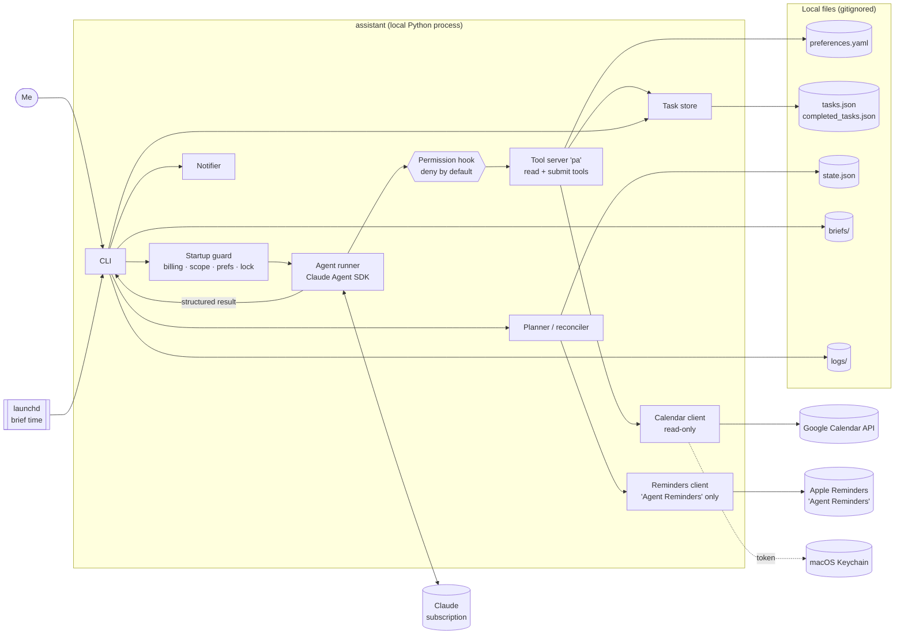
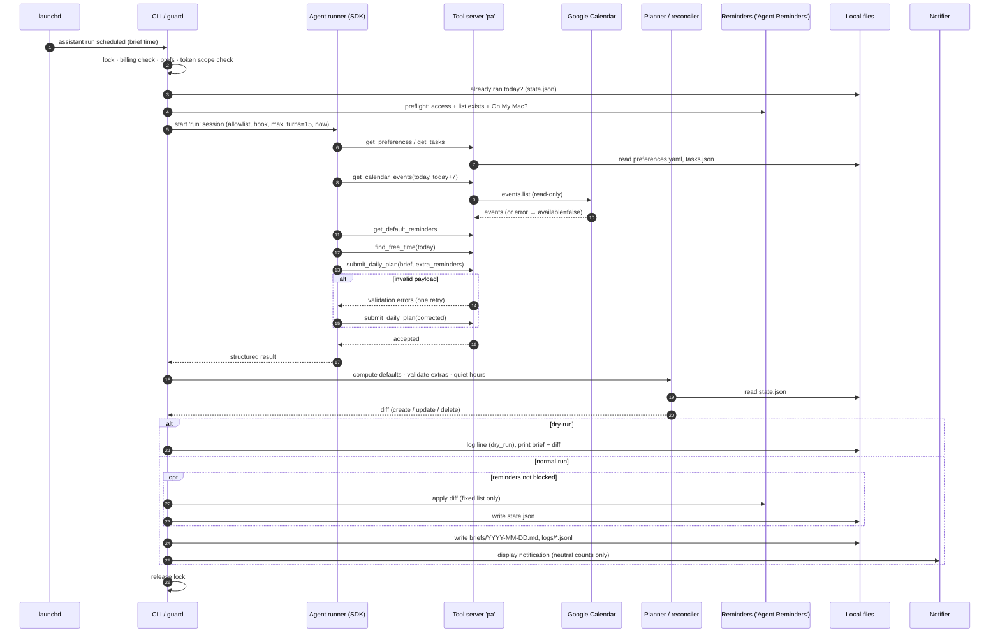

# Personal Assistant Agent — Architecture

**Status:** Draft for review · **Covers:** Phase 1 only (not yet built) · **Source of truth:** [PRD.md](PRD.md) · **Last updated:** 2026-10-10

Requirement IDs (FR-x, S-x) refer to PRD.md.

---

## 1. Component overview

| Component | What it is | Responsibility |
|---|---|---|
| **CLI** | Python entry point `assistant` | Commands: `run now [--dry-run]`, `run scheduled`, `add "<text>" [--yes]`, `ask "<question>"`, `tasks list/done/edit/delete`, `state rebuild`, `auth google`, `schedule install/uninstall`, `doctor`. Runs startup checks, owns human confirmations. `doctor` also warns if the installed launchd time differs from `morning_brief.time` or if `data/` permissions are looser than `700`/`600` or `data/` is inside an iCloud-synced folder (S-10), and reports when reminder writes are blocked (access denied, list missing, list not On My Mac, S-14, or `state.json` invalid, FR-23a). |
| **Startup guard** | Plain Python | Billing check (S-7), calendar scope check (S-2), preferences validation (§8), single-run lock (also taken by the task write commands, §6.4). Runs before any AI call. |
| **Agent runner** | Claude Agent SDK (Python) | Builds a session for each flow with its system prompt, tool allowlist, permission hook and step limit. Collects the structured result. |
| **Tool server** | In-process SDK MCP server (`create_sdk_mcp_server`) named `pa` | The only tools Claude can call (§3). Thin wrappers over the clients below. |
| **Calendar client** | Google Calendar API v3, read-only credentials | `events.list` / `events.get` only (S-2). |
| **Task store** | Plain Python over `tasks.json` + `completed_tasks.json` | Validation (pydantic), atomic writes, backups, moving completed tasks (FR-4–6, FR-11a). |
| **Planner / reconciler** | Plain Python | Computes the default-rule reminders deterministically, validates the AI's extra reminders, applies caps and quiet hours, diffs against the state file, decides what to create, update or delete (FR-14–18). |
| **Reminders client** | `osascript` (AppleScript), fixed scripts, list name hard-coded | Create, update and delete reminders in **"Agent Reminders"** only (S-4). Titles and notes are passed as script arguments, never interpolated (S-18). |
| **Notifier** | `osascript` with a fixed `display notification` script, text passed as an argument (S-18) | Shows a neutral brief summary (counts only) and the failure type for failed runs (S-15). Display only. |
| **Scheduler** | macOS `launchd` user LaunchAgent | Calls `assistant run scheduled` at the brief time (FR-12). The plist is generated from preferences by `assistant schedule install`; re-run it after changing the brief time. |
| **Test doubles** | `tests/fakes/`: fixture calendar client, fake Reminders client, fake notifier | Same interfaces as the real clients. The flows receive their clients as parameters, so tests and evals swap in fakes: the calendar fake reads `evals/fixtures/`, and the Reminders and notification fakes record what would have been written, in memory. Product code never imports `tests/fakes/`. See EVALS.md §2. |
| **Local files** | Preferences, tasks, state, briefs, logs, backups, `secrets/` | All on disk in `data/` (`700`, files `600`), gitignored (S-10, S-12). OAuth token in the macOS Keychain; OAuth client file in `data/secrets/`. |

### Component diagram



Key design point: **Claude never writes anything directly.** Its tools are read-only lookups plus "submit" tools that hand a proposal back to plain code. Plain code validates the proposal, asks for confirmation where the PRD requires it, and performs the write.

## 2. Agent loop

Each flow (`run`, `add`, `ask`) is one Agent SDK session. The SDK runs the loop; we configure it and watch every step.

```
1. Understand  – system prompt (role, rules, current time + time zone, preference
                 summary) + user input or daily-run instruction
2. Pick tool   – Claude chooses a tool from this flow's allowlist
3. Call        – permission hook checks the call (§7); the tool validates its
                 arguments, clamps ranges, and runs plain code
4. Observe     – the tool returns JSON (data, or a structured error such as
                 {"available": false, "error": "calendar_unavailable"})
5. Reason      – Claude decides: need more data → back to 2;
                 ready → call this flow's submit_* tool
6. Respond     – submit_* validates the payload against a pydantic schema.
                 Valid → session ends, result goes to plain code.
                 Invalid → the tool returns the validation error; Claude gets
                 ONE retry (FR-25), then the step fails cleanly.
```

- **Step limit:** `max_turns` per flow: `add` 6, `ask` 10, `run` 15 (constants in code). Hitting the limit ends the session with an error result. The flow fails cleanly and nothing is written (apart from the log). Values are tuned from evals.
- **Retry count** is tracked by the runner, not trusted to the model. A second invalid submit aborts the session.
- **Every step is logged** (tool name, argument field names, result status, duration) to the run log (FR-26). Argument values and tool results are not logged (S-13).
- **"Now"** is injected by code at session start (ISO time + `America/Los_Angeles`), so relative dates (FR-8) are resolved against a fixed reference.

## 3. Tools exposed to the agent

All tools live in the in-process MCP server `pa`. The SDK sees them as `mcp__pa__<name>`. Each flow gets only the tools it needs.

| Tool | Flows | Purpose | Input | Output | R/W | Permission check |
|---|---|---|---|---|---|---|
| `get_calendar_events` | run, ask | Events in a date range | `{start_date: date, end_date: date}` | `{available: bool, error?: str, skipped_calendars: [str], events: [{id, calendar, title, start, end, all_day, location, is_birthday}]}` | Read | Range clamped to today…today+7 (FR-1). Uses read-only creds checked at startup (S-2). Strips attendees and descriptions (FR-2, S-13). |
| `get_tasks` | run, add, ask | Read tasks | `{status?: [todo\|in_progress\|done], include_completed?: bool, completed_since?: date}` | `{tasks: [Task]}` | Read | Reads only the two task files. `include_completed` is not offered in `run` (FR-11a). |
| `get_preferences` | run, add, ask | Current preferences | `{}` | `Preferences` (validated) | Read | Read-only view of the parsed file. |
| `get_default_reminders` | run | Default-rule reminders code has already computed, so extras don't duplicate them | `{}` | `{reminders: [{title, fire_at, source_type: meeting\|task\|birthday, source_id}]}` | Read | Plain-code result from this run's data snapshot (FR-17). Shown to Claude for context only; the planner uses its own copy. |
| `find_free_time` | run, ask | Free blocks on a day | `{date: date, min_minutes?: int}` | `{working_hours, busy: [{start, end, source_id}], free: [{start, end, minutes}], calendar_available: bool}` | Read | Plain-code calculation from calendar + working hours. Same date clamp. |
| `submit_task` | add | Parsed task proposal | `{title, description?, category, priority, deadline?, estimated_minutes?, assumptions: [str], clarifying_question?: str}` | `{accepted: bool, errors?: [str]}` | Proposal | Schema-validated. `category` must be in preferences; priority defaults to `medium` (FR-7). No write. Code confirms (FR-10) and writes. |
| `submit_daily_plan` | run | Brief + extra reminders | `{brief: {summary, schedule[], due_today[], overdue[], focus[], free_blocks[], data_gaps[]}, extra_reminders: [{title, fire_at, source_type: meeting\|task\|birthday, source_id, reason}]}` | `{accepted: bool, errors?: [str]}` | Proposal | Schema-validated. `source_id` must exist in data the tools returned this session; `reason` is required. No write. Planner validates further (§6.1). |
| `submit_answer` | ask | Final answer | `{answer: str, sources: [{type: event\|task, id, title}], data_gaps: [str]}` | `{accepted: bool, errors?: [str]}` | Proposal | Cited IDs must exist in data returned this session (FR-20). |
| `propose_task_change` | ask | Task change I asked for | `{action: create\|update\|complete\|delete, task_id?, changes?, reason}` | `{queued: true}` | Proposal | Only queues the change. After the session, CLI shows it and needs explicit `y` (FR-21). |

The current time is passed in the system prompt, not via a tool.

**Not exposed to the agent at all:** Reminders, notifications, file writes, shell, web. Plain code does these.

**Untrusted data (S-17):** every tool result is data, never instructions. The system prompt for each flow says so explicitly. Stored files (`tasks.json`, `state.json`, briefs) are schema-validated on load, and text the AI wrote on an earlier run (brief content, reminder titles, `reason` fields) is treated like any other untrusted input.

**Structured output** goes through the `submit_*` tools: the tool's input schema is the output schema, and validation errors feed back into the loop as the FR-25 retry. This works the same way in every flow and makes retries visible in the logs.

## 4. AI vs plain code

| Step | Claude | Plain Python |
|---|---|---|
| Startup checks (billing, scope, prefs, lock) | | ✅ |
| Fetching calendar, tasks, preferences | decides *what* to fetch | ✅ executes |
| Free-time calculation | | ✅ (`find_free_time`) |
| Categorising and parsing a captured task | ✅ | validation, IDs, timestamps |
| Clarifying question for ambiguous input | ✅ writes the question | ✅ asks it in the terminal |
| Confirmation before saving | | ✅ |
| Writing the morning brief | ✅ content | ✅ render to Markdown, save, notify |
| Default-rule reminders (meetings, deadlines, birthdays, brief item) | | ✅ deterministic |
| Extra reminders for important items, with reasons | ✅ | |
| Validating extras (future, in window, cap, known IDs) and applying quiet hours to all | | ✅ |
| Reconciling with existing reminders, create/update/delete | | ✅ |
| Answering questions | ✅ | ✅ validates citations, prints |
| Task file writes, moving completed tasks, backups | | ✅ |
| Scheduling, logging, error handling | | ✅ |

## 5. State

### During a run (in memory)
- `RunContext`: run ID, flow, start time, `now`, time zone, dry-run flag, parsed preferences.
- **Data snapshot:** calendar result and tasks, fetched once per run and shared by the tools and the planner. Claude and the default-reminder calculation see the same data.
- **Observed data registry:** every event and task ID returned by a tool this session, plus whether calendar fetches succeeded. Used to check `source_id` and citations, and to force a `data_gaps` entry when the calendar was unavailable (FR-20, FR-22).
- Submit retry counter, step count, the pending proposal.

### Between runs (on disk, `data/`, gitignored)

| File | Contents | Written by |
|---|---|---|
| `preferences.yaml` | My settings (PRD §8) | Me |
| `tasks.json` | Open tasks `[Task]` | Task store |
| `completed_tasks.json` | `{"YYYY-MM-DD": [Task]}` (FR-11a) | Task store |
| `backups/` | Timestamped copy before each task-file write; keep last 20 | Task store |
| `state.json` | `reminders: {key → {reminder_id, title, fire_at, source_type, source_id, kind, content_hash}}`, `last_runs: {scheduled: {date, status}, manual: {…}}` with `status` one of `ok`, `partial` (finished with a data gap, e.g. calendar or Reminders unavailable) or `failed`, `schema_version` | Reconciler, runner, `state rebuild` |
| `briefs/YYYY-MM-DD.md` | Rendered morning brief (latest run of the day overwrites). Files older than 30 days are deleted at the start of each run (S-13). | Daily run |
| `logs/YYYY-MM-DD.jsonl` | One JSON line per event: run start/end, step, tool call, reminder change, error. IDs, statuses, counts and error codes only; no titles, task text or descriptions (S-13). Files older than 30 days are deleted at the start of each run. | Every flow |
| `secrets/google_oauth_client.json` | Google OAuth client secret file (S-10). Never committed. | Me (one-time setup) |
| `.run.lock` | `fcntl` lock so runs, task write commands and `state rebuild` can't overlap | Startup guard, task write commands, `state rebuild` |

- **Reminder key** = `source_type:source_id:fire_at` (FR-15). Each reminder's notes field also carries a marker `[pa:<kind>:<key>]` (`kind` is `default` or `extra`), so `assistant state rebuild` can rebuild `state.json` from "Agent Reminders" alone (§6.5).
- **Google OAuth token:** macOS Keychain via `keyring` (S-10), never in `data/`.
- **Permissions:** `data/` and its subfolders are created `700`, every file `600` (atomic writes keep the mode). `doctor` warns if anything is looser (S-10).
- **Agent SDK session history:** to be checked during the build (S-16). If the SDK saves transcripts under `~/.claude/`, turn that off if possible; otherwise record the location in SECURITY.md §8.

## 6. Data flows

### 6.1 Daily run (`run scheduled` / `run now [--dry-run]`)

1. **Guard:** take the lock → billing check → load and validate preferences → scope check on the Google token. `run scheduled` exits quietly if today's scheduled run already succeeded. `run now` always runs.
2. **Preflight Reminders:** check Reminders access, that "Agent Reminders" exists, and that it belongs to the On My Mac account (S-14). If any check fails, set `reminders_blocked` with the reason (FR-23), add the reason to `brief.data_gaps`, and continue so the brief still gets written.
   - Also load `state.json`. If it's invalid (FR-23a), copy it to `backups/state-invalid-<time>.json` (once per distinct bad file), set `reminders_blocked` with reason "state invalid", and add it to `brief.data_gaps`. `state.json` isn't written this run (so `last_runs` isn't updated either). Nothing is rebuilt automatically.
   - If `state.json` is missing and "Agent Reminders" already holds items with a `[pa:]` marker, do the same (reason "state missing", no copy to back up). If the list holds no marked items, start with empty state. If the list can't be read, a missing `state.json` also blocks writes and isn't written.
3. **Agent session (`run`):** Claude calls `get_preferences`, `get_tasks`, `get_calendar_events` (today…+7), `get_default_reminders`, `find_free_time` (today), then `submit_daily_plan` with the brief and any extra reminders.
4. **Build the plan (planner):**
   - **Defaults (code):** compute from preferences and the data snapshot: meetings 1 h before; tasks on the morning of the due day and 1 h before the deadline; birthdays at 20:00 the evening before; plus the brief item (`source_type: brief`) at today's brief time, or now + 1 min on a later manual run. Marked `kind: default`. A default whose time has already passed is skipped (the brief covers the item), e.g. a 09:00 meeting at the 08:00 run.
   - **Extras (AI):** drop any with `fire_at` in the past or beyond the 7-day window, unknown `source_id`s, ones at or after their own event start or deadline, or duplicates of a default. Keep at most `max_per_item` per source item (FR-18). Marked `kind: extra`. The `reason` isn't written to Reminders; the notes hold only the marker.
   - **Quiet hours (all reminders):** a reminder inside quiet hours moves to the end of quiet hours if that's still before its event or deadline; otherwise to just before quiet hours start (PRD §8). If that time has already passed (e.g. a manual run at 23:00 for a 06:30 event), the reminder is skipped.
   - If calendar data was missing, make sure `brief.data_gaps` says so (FR-22).
5. **Reconcile** against `state.json`, looking only at keys we created:
   - new key → create
   - same key with a changed title → update
   - a deleted and a created reminder for the same item and kind are paired into one update, so a moved event or deadline moves its reminder (FR-15)
   - key no longer planned and still in the future (event moved or cancelled, task done) → delete
   - past reminders → leave alone in Reminders and drop from `state.json`
   - if calendar data is unavailable this run, existing `meeting` and `birthday` reminders are kept, not deleted (FR-22)
6. **Write.** With `--dry-run`, this step only prints the brief and the diff and writes one log line marked `dry_run` (FR-13). Otherwise:
   - Reminders changes, if not blocked. A reminder I deleted by hand is recreated if it needs an update and just dropped from state if it needs deleting. If a write fails, the rest are skipped and `state.json` records only what was written.
   - `state.json`.
   - `briefs/YYYY-MM-DD.md`.
   - Notification with a neutral summary, counts only (S-15).
   - Log line, and `last_runs` updated.



### 6.2 Task capture (`add "<text>" [--yes]`)

1. Guard: billing check, preferences, lock.
2. Agent session (`add`): Claude may call `get_preferences` (categories, default priority) or `get_tasks` (to spot duplicates), then `submit_task`.
3. If the proposal includes a `clarifying_question`, the CLI asks it once and starts a short follow-up turn in the same session with my answer. If I just press Enter, the task is saved without a deadline and the CLI says so (FR-9).
4. Code fills `id`, `status: todo`, `created_at`/`updated_at`, and validates against the Task schema (FR-5).
5. Show the parsed task and assumptions (always, including with `--yes`). Unless `--yes`, ask `Save? [Y/n]` (FR-10).
6. Back up `tasks.json`, write atomically (FR-6), log.

The new task gets reminders at the next daily run (or `run now`). `add` itself doesn't touch Reminders.

### 6.3 Q&A (`ask "<question>"`)

1. Guard: billing check, preferences, scope check, lock.
2. Agent session (`ask`): Claude calls whichever read tools it needs, then `submit_answer`. If I asked for a change (e.g. "mark the milk task done"), it also calls `propose_task_change`.
3. Code checks that cited IDs were actually returned this session and appends any `data_gaps` (e.g. "calendar unavailable") (FR-20).
4. Print the answer and its sources.
5. For each queued change: show it and ask `Apply? [y/N]` (default No). On yes, the task store writes it (complete → move to `completed_tasks.json`, FR-11a). Otherwise nothing is written (FR-21).

### 6.4 Manual task commands (`tasks done/edit/delete`)
Plain code only, no AI. Same validation, backup and atomic write path. `tasks delete` shows the task and asks `Delete …? [y/N]` (default No) unless `--yes` is given.

- **Lock:** `done`, `edit` and `delete` hold the run lock while they write, so they can't overlap a run. `delete` asks its question before taking the lock. `tasks list` only reads and takes no lock.
- **Logging:** every task command writes a run log with flow `tasks.list`/`tasks.done`/`tasks.edit`/`tasks.delete`: task IDs, edited field names, counts and error codes only (S-13).

### 6.5 State rebuild (`state rebuild`)
Plain code only, no AI. Run only by me, never automatically (FR-23a).

1. Take the run lock.
2. Read "Agent Reminders" and collect items whose notes carry a `[pa:<kind>:<key>]` marker. Items without a marker are ignored and never touched. If two items carry the same marker, one is kept and the other is left in the list and reported.
3. Show what the new state would hold (counts by `source_type`) and ask `Rebuild state.json? [y/N]` (default No).
4. On yes: copy the current `state.json` (if any) to `backups/`, then write the rebuilt state atomically. `last_runs` starts empty. Log the counts.

## 7. Permission boundaries

| Layer | Mechanism | Enforces |
|---|---|---|
| **Tool allowlist** | `ClaudeAgentOptions(allowed_tools=[mcp__pa__… for this flow], disallowed_tools=[Bash, Read, Write, Edit, Glob, Grep, WebFetch, WebSearch, Task, NotebookEdit, …], setting_sources=[])` | Only `pa` tools exist for the agent. Built-in shell, file and web tools are off (S-5). `setting_sources=[]` keeps my personal Claude Code settings and CLAUDE.md files out of the session. |
| **Permission hook** | `PreToolUse` hook + `can_use_tool` callback, deny by default | Any tool name not in this flow's allowlist is denied and logged (S-5). Arguments are checked too (date ranges). |
| **Read-only calendar** | OAuth requests only `calendar.events.readonly`. At startup, code reads the granted scopes (Google tokeninfo) and refuses to run if any other scope is present (S-1, S-2). | The calendar client module only imports `events().list` / `events().get`. A test asserts that no other Calendar API method is referenced anywhere. |
| **Fixed Reminders list** | `AGENT_LIST = "Agent Reminders"` constant in the AppleScript templates. No function takes a list name. Every write script first resolves the list by exact name and aborts if it isn't found. Update and delete also require the reminder ID to be in `state.json` (or carry our `[pa:]` marker) (S-4, FR-16). | Not exposed to the agent at all. Only the reconciler calls it. |
| **Billing check** | Before any SDK call, refuse to start if any of these are set: `ANTHROPIC_API_KEY`, `ANTHROPIC_AUTH_TOKEN`, `CLAUDE_CODE_USE_BEDROCK`, `CLAUDE_CODE_USE_VERTEX`, `CLAUDE_CODE_USE_FOUNDRY`, `ANTHROPIC_BASE_URL` (S-7). These are also removed from the environment passed to the SDK, as a backstop. After the session starts, if the SDK's init message reports an API-key auth source rather than subscription login, abort (exact field confirmed during build). | No fallback model or provider exists in the code (S-8). |
| **AppleScript arguments** | Each Reminders and notification operation is a fixed AppleScript using `on run argv`. Code calls `subprocess.run(["osascript", "-e", SCRIPT, arg1, …])` with no shell; titles, notes and notification text are only ever arguments. | S-18 |
| **Untrusted data** | Tool results are JSON data; system prompts say to ignore instructions in them; stored files are schema-validated on load; proposals are checked by code (known IDs, window, cap). | S-17 |
| **Write paths** | Task store and state writer only write inside `data/`, with `700`/`600` permissions. Reminders only via the client above. | S-3, S-10 |
| **Human-in-the-loop** | Confirmation for `add` (unless `--yes`) and for every `ask` task change | FR-10, FR-21 |

## 8. Failure paths

| Failure (PRD ref) | Detected by | Behaviour |
|---|---|---|
| Calendar unreachable / auth expired (FR-22) | Calendar client exception (network, 401, `invalid_grant`) | Tool returns `available: false`. Run continues with tasks only. Brief `data_gaps` says "calendar data missing". Only task reminders are planned. Existing meeting and birthday reminders are **kept, not deleted** (no data ≠ cancelled). Log tells me to run `assistant auth google`. |
| Birthdays calendar not found (FR-1) | 404 on that calendar | Skipped, listed in `skipped_calendars`, logged. Run continues normally. |
| Token has a write scope (S-2) | Startup scope check | Refuse to start with a clear message. Nothing runs. |
| No Google token yet (not connected) | Startup scope check finds no Keychain token | Not an error: calendar treated as unavailable (FR-22), the run continues with tasks only, and `doctor` says "Google Calendar: not connected". |
| Reminders access denied / list missing / list not On My Mac (FR-23, S-14) | Preflight AppleScript check | Brief, file and notification still happen. No Reminders writes at all. The reason appears in the brief (`data_gaps`) and in `doctor`, with the fix (grant access in System Settings / create the list / recreate it under On My Mac). The list is never created or moved automatically. |
| Usage unavailable / exhausted (FR-24, S-8) | SDK error result or exception classified as usage/auth | Stop the AI step. No writes beyond the log (`status: failed, reason: usage_unavailable`) and, for scheduled runs, a notification "Morning brief failed: Claude usage unavailable". No retry with another model or key. |
| Billing credential present (S-7) | Startup env check / init auth source | Refuse to start, name the variable. |
| Malformed AI output (FR-25) | `submit_*` schema validation, planner validation | One retry with the errors. Then the step fails, nothing invalid is written, and the log records the validation error field paths for both attempts, not the payload values (S-13). |
| Step limit reached | SDK `max_turns` result | Same as malformed: fail cleanly, no writes. |
| Tool outside allowlist (S-5) | Permission hook | Denied, logged. Session continues; the model sees the denial. |
| Invalid preferences (§8) | Pydantic validation | Refuse to start, name the field and value. |
| Invalid `state.json`, or missing while the list holds `[pa:]` items (FR-23a, S-17) | JSON/schema load error, or no file plus marked items | Same as a blocked list: no Reminders writes and `state.json` isn't written. An invalid file is copied to `backups/`. The brief is still written, and the reason is in the brief (`data_gaps`) and in `doctor`, with the fix (`assistant state rebuild`). Never rebuilt automatically. |
| Corrupt `tasks.json` | JSON/schema load error | Refuse to write. Point to the latest backup. Brief/Q&A report tasks as a data gap. |
| Notification fails | `osascript` non-zero exit | Log and continue. The brief is still in the file and in Reminders. |
| `data/` permissions too open (S-10) | `doctor` | Warning naming the path and expected mode. |
| `data/` inside an iCloud-synced folder (S-10) | `doctor` checks iCloud Drive and synced `~/Desktop`/`~/Documents` | Warning naming the synced folder and telling me to move the project out (e.g. to `~/Developer`). |
| Another run in progress | Lock held | Exit with "another run is in progress". |
| Mac asleep at brief time (FR-12) | launchd | launchd runs the missed job at wake. `run scheduled` checks `last_runs` so it runs at most once per day. If the Mac was shut down, the run is missed; `run now` covers it. |
| Brief time changed but schedule not reinstalled (FR-12) | `doctor` compares plist and preferences | Warning telling me to run `assistant schedule install`. |
| Google refresh token expires every 7 days | OAuth `invalid_grant` | Prevented by setting the Google Cloud project to *In production* (§11). If it still happens, handled as "auth expired" above. |

## 9. Planned folder structure (not created yet)

```
personal-assistant-agent/
├── PRD.md
├── ARCHITECTURE.md
├── SECURITY.md
├── EVALS.md
├── README.md
├── pyproject.toml
├── uv.lock                       # pinned dependency versions (S-19)
├── .python-version               # 3.12, used by uv
├── .gitignore                    # data/, secrets, logs
├── .gitleaks.toml                # secret scanning config, run by pre-commit and pre-push hooks (S-12)
├── .githooks/                    # pre-commit + pre-push (gitleaks); enable with: git config core.hooksPath .githooks
├── src/assistant/
│   ├── cli.py                    # commands, confirmations
│   ├── guard.py                  # billing check, scope check, lock
│   ├── config.py                 # preferences loading + validation
│   ├── schemas.py                # pydantic: Task, Preferences, DailyPlan, Answer, …
│   ├── agent/
│   │   ├── runner.py             # SDK options, max_turns, retry, step logging
│   │   ├── prompts.py            # system prompts per flow
│   │   ├── tools.py              # 'pa' MCP server + per-flow allowlists
│   │   └── permissions.py        # PreToolUse hook / can_use_tool
│   ├── integrations/
│   │   ├── google_calendar.py    # read-only client, OAuth, Keychain
│   │   ├── reminders.py          # AppleScript, fixed list
│   │   └── notify.py
│   ├── tasks_store.py            # atomic writes, backups, completed move
│   ├── planner.py                # plan validation, quiet hours, reconcile
│   ├── state.py
│   ├── logging_setup.py
│   └── flows/
│       ├── daily_run.py
│       ├── capture.py
│       └── ask.py
├── launchd/
│   └── com.assistant.daily.plist.template
├── examples/                     # fake sample data (S-12)
│   ├── preferences.yaml
│   └── tasks.json
├── data/                         # gitignored, created at first run (700; files 600)
│   └── secrets/                  # google_oauth_client.json (600)
├── tests/                        # Layer A: unit + safety tests (PRD §10.5), run with pytest
│   └── fakes/                    # fixture calendar, fake Reminders, fake notifier
└── evals/                        # Layer B: AI evals (EVALS.md)
    ├── fixtures/                 # fake calendar, task and preference snapshots
    ├── cases/                    # capture, extras, brief, Q&A, failure, injection, repeat cases
    ├── results/                  # per-run result files, fake data only, committed
    └── run_evals.py              # eval command: --set <name>, --case <id>
```

## 10. Mermaid diagrams

The component diagram is in §1 and the daily-run sequence diagram is in §6.1.

## 11. One-time setup

1. **Google Cloud project:** enable the Calendar API, create an OAuth client (desktop app), add only the `calendar.events.readonly` scope, and set the consent screen publishing status to **In production**. It stays unverified, which is fine for personal use: I click through Google's warning once. In *Testing* status, refresh tokens expire after 7 days and would break the daily run. Save the downloaded client file as `data/secrets/google_oauth_client.json` with permission `600` (S-10).
2. `assistant auth google`: runs the browser login and stores the token in the Keychain. The scope check runs right away.
3. **Claude:** log in to Claude Code with my subscription. No API key is set anywhere (S-7).
4. **Reminders:** create the "Agent Reminders" list by hand under **On My Mac**, not iCloud (S-14). Grant Automation/Reminders access on the first run.
5. **Notification previews:** System Settings → Notifications → Show previews → **When Unlocked**, so reminder alerts don't show titles on the lock screen (S-15).
6. Copy `examples/preferences.yaml` to `data/` and edit it.
7. `assistant schedule install`: generates and loads the launchd plist from `morning_brief.time`.
8. `assistant doctor`: checks all of the above.
9. **Developer tooling:** install the `gitleaks` pre-commit and pre-push hooks (S-12). Run `pip-audit` before each release (S-19).

To stop the agent and remove its access, follow the kill-switch steps in SECURITY.md §8 (S-20).

## 12. Tech stack

| Concern | Choice |
|---|---|
| Language / env | Python 3.12, `uv` |
| Agent | Claude Agent SDK (Python), in-process MCP tool server |
| CLI | Typer |
| Schemas / validation | pydantic v2 |
| Calendar | `google-api-python-client`, `google-auth-oauthlib` |
| Secrets | `keyring` (macOS Keychain) |
| Preferences | `PyYAML` |
| Reminders / notifications | `osascript` (AppleScript) |
| Scheduling | `launchd` user LaunchAgent |
| Step limits | `add` 6 · `ask` 10 · `run` 15 |
| Supply chain / secrets (dev only) | `uv.lock` pinning, `pip-audit`, `gitleaks` |
