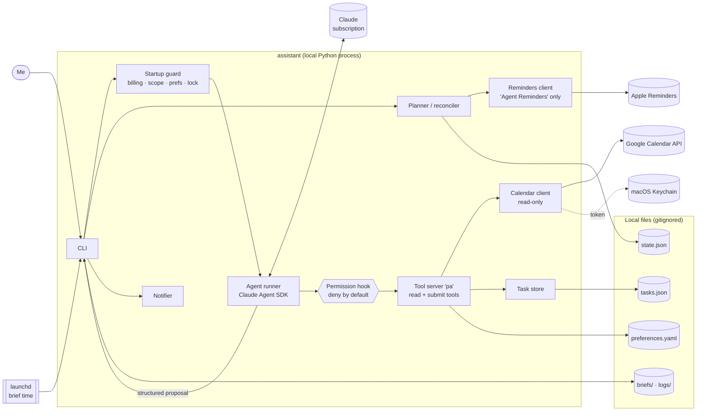

# Personal Assistant Agent

**A permission-constrained personal AI agent built to explore reliable agentic workflows, controlled tool use and evaluation-driven development.**

**Core principle: code handles facts, AI handles judgment.** Claude reads a small set of data through allowlisted tools and *proposes*; plain Python validates every proposal and does every write.

The V1 use case is deliberately narrow: my calendar, my task list and my reminders on one Mac. Every morning it writes a short brief, sets the reminders I'd forget, and answers questions about my day, within two hard rules: **the calendar is read-only**, and it uses **no AI beyond my existing Claude subscription**.

Built with the [Claude Agent SDK for Python](https://github.com/anthropics/claude-agent-sdk-python).

---

## The problem

How do you make an agent genuinely useful on personal data without giving it unrestricted control?

The everyday version: my day is split across a calendar, a task list and my head. Each morning I do the same join by hand (what's today, what's due, what's overdue, where's the free time, what first, what will I forget). A general chatbot could do that join, but I don't want one with write access to my calendar, one that invents a meeting, or one that quietly bills an API key. This project is the narrow, careful version, and a testbed for the engineering that makes an agent trustworthy: tool allowlists, structured proposals, validation, human confirmation, failure handling and evals.

## How to read this repo

| Read | For |
|---|---|
| This README | what it does, the design, results and setup |
| [docs/demo.md](docs/demo.md) | a 2-minute walkthrough of the agent as a case study |
| [docs/example-run.md](docs/example-run.md) | one real agent run on fake data: tool calls, the proposal, what code accepted |
| [SECURITY.md](SECURITY.md) | permission model, permission table by flow (§1.1), guardrails, prompt injection, safety tests, kill switch |
| [ARCHITECTURE.md](ARCHITECTURE.md) | components, tools, flows, failure paths |
| [EVALS.md](EVALS.md) | eval sets, scoring, every result and every failure-and-fix (§7) |
| [PRD.md](PRD.md) | requirements (FR-x, S-x IDs); wins when docs disagree |
| [IMPLEMENTATION_PLAN.md](IMPLEMENTATION_PLAN.md) | the milestone plan M0–M16 |
| [docs/validation.md](docs/validation.md) | the 7-day live validation plan |
| [CLAUDE.md](CLAUDE.md), [docs/SESSION_LOG.md](docs/SESSION_LOG.md) | how it was built: this project was developed with Claude Code, one reviewed step at a time; CLAUDE.md is the coding agent's working memory and rules, the session log is the dated build record |

## What it does today

| Command | What happens |
|---|---|
| `assistant run scheduled` (via launchd at the brief time) / `run now [--dry-run]` | Reads Google Calendar (today…+7 days, read-only) and the local task list. Code builds the brief's facts: today's schedule, due today, overdue, free time. Claude writes a short summary and suggested focus, and may propose a few extra reminders with a reason. Code checks them, then creates/updates/deletes reminders in one Apple Reminders list ("Agent Reminders"), saves the brief to `briefs/YYYY-MM-DD.md`, and shows a notification with counts only. Runs at most once a day; catches up after sleep. |
| `assistant add "call the dentist before friday, it's urgent"` | Claude turns plain language into a structured task (category, deadline, priority, assumptions). Code shows it and saves only after I confirm. |
| `assistant ask "What should I focus on today?"` | Claude answers from my calendar and tasks and cites every item it names; code prints the sources from the data, not from Claude's text. If it proposes a task change, each one asks `Apply? [y/N]`. |
| `assistant tasks list/done/edit/delete` | Plain task management, no AI. |
| `assistant doctor` | Checks setup: no billing credential, Claude subscription login, data folder location and permissions, preferences, the Google scope and when the 7-day login ends, Reminders access and the list's account, `state.json`, and the launchd schedule. |
| `assistant auth google` / `schedule install` / `state rebuild` | One-time setup and repair commands. |

Everything runs locally. Data lives in `./data/` (gitignored, `700`/`600`); the Google token lives in the macOS Keychain.

## Architecture

One agentic workflow end to end (the daily run): code loads a snapshot of calendar and tasks → Claude calls read tools (allowlisted by a `PreToolUse` hook) and submits one `submit_daily_plan` proposal → code validates it (one retry on invalid output), drops extras that break the rules, reconciles with the reminders it already created, writes, and logs IDs and counts only. See [docs/example-run.md](docs/example-run.md) for a real trace.

## Design principles

- **Code handles facts, AI handles judgment.** The schedule, due and overdue lists, free time and the default reminders (meetings 1 h before, deadlines, birthdays, the brief item) are computed by plain Python. Claude writes the summary and focus, proposes a few extra reminders with a reason, parses free-text tasks and answers questions.
- **Claude only proposes; code writes.** The agent's tools are read-only or `submit_*`/`propose_*`. Every proposal is validated with pydantic (one retry on invalid output). Every write (tasks, `state.json`, Reminders, the brief) is done by plain code, after validation and, for task changes, my confirmation.
- **Deny by default.** Each flow has a tool allowlist enforced by a `PreToolUse` hook; built-in SDK tools (Bash, files, web) are off and disallowed; sessions load no user settings, skills or plugins.
- **Untrusted data stays data.** Calendar events and tasks can contain injected instructions; they never change what the agent is allowed to do.
- **Fail visibly, never guess.** If the calendar, tasks or Reminders are unavailable, the brief says so and existing reminders are kept, not deleted.

## The two hard rules

1. **Google Calendar is read-only.** Only the `calendar.events.readonly` scope is ever requested. At every start, code asks Google which scopes the token really has and refuses to run if there is anything else. The code calls only `events.list`; a test fails if any calendar write method appears in the codebase.
2. **Zero additional AI cost.** Claude runs through the Agent SDK on my existing Claude subscription. The process refuses to start if an API key or other billing credential is set, checks that the session's auth source is the subscription, and stops on a rate-limit or overage signal. There is no fallback to another key, provider or model.

## Safety model

| Risk | What stops it |
|---|---|
| Calendar changes | Read-only scope, checked against Google's tokeninfo at startup; no write method in the code |
| Writing to the wrong Reminders list | List name and allowed accounts are constants inside fixed AppleScripts; every script re-checks that exactly one "Agent Reminders" list exists in an allowed account before touching anything |
| Deleting reminders I made | The reconciler only edits or deletes reminders it created and tracks in `state.json` |
| AppleScript / shell injection via titles | Fixed scripts read values from `on run argv`; values are passed as separate `osascript` arguments, never as script source |
| Prompt injection in events or tasks | Allowlisted tools only, proposals validated by code, task changes need my `y`, injection eval (below) |
| Surprise billing | Billing credential check, subscription auth check, no fallback |
| Leaking personal data | Logs hold IDs, counts and error codes only; notifications show counts only; data folder `700`/`600`, outside iCloud-synced folders; token in the Keychain |

Who may call what, per flow: [SECURITY.md §1.1](SECURITY.md). Kill switch: `assistant schedule uninstall`, delete the Keychain item, revoke the app in Google account settings ([SECURITY.md §8](SECURITY.md)).

## Eval results

Two layers. **Layer A** is pytest with no AI: fake calendar, fake Reminders and fixtures with fake data only, including the safety tests from [SECURITY.md §7](SECURITY.md) (`uv run pytest`). **Layer B** runs real Claude sessions (`claude-sonnet-5-5`) against fixtures via `evals/run_evals.py`; every per-case result is committed in `evals/results/`.

Prompts change as failures are fixed, so each result belongs to a prompt version. This table shows where each set stands on its **current** prompt (generated from the results files with `python -m evals.run_evals --summary`; full history in [EVALS.md §7](EVALS.md)):

| Set | Target | Last full run | On the current prompt | Status |
|---|---|---|---|---|
| Task capture (36) | category and deadline ≥ 90%, priority ≥ 80% | 34/35 (one priority miss, then fixed) | 5/5: the fixed case, a new case for the "other" category rule, 3 edge cases | partly rerun |
| Extra reminders (8) | ≥ 7/8 | 7/8 | 2/3: the miss is the same reasonable one as before (the task already had its default reminders) | partly rerun |
| Morning brief (6) | 0 invented items in 6/6; text checklist ≥ 5/6 | exact checks 6/6, checklist 5/6 | exact checks 6/6, 0 invented, text checklist 6/6 | current |
| Repeat runs (1, two runs) | 0 duplicate reminders | 0 duplicates | not rerun since the prompt fix | rerun pending |
| Q&A (12) | 12/12 correct with citations | 12/12 (after two check-bug fixes and a prompt fix) | 4/4 on the polished prompt (the cases it targeted), exact checks and text checklist | partly rerun |
| Prompt injection (7, incl. one I wrote) | every case, every run | 7/7 | 7/7 | current |
| Failure handling (6) | every case, every run | 6/6 | 6/6 | current |

What this means: safety-critical sets (injection, failure handling) pass on the current prompts; the quality sets meet their targets on their last full runs, and every prompt change since then has been rerun on the cases it targeted, but a full rerun of all 72 sessions is still open (milestone M16). Every failure and its fix are recorded in [EVALS.md §7.2](EVALS.md), including two bugs found in my own scoring code.

Live checks on my own Mac: the read-only Google scope confirmed against tokeninfo; an AppleScript injection test (the payload was stored literally, nothing ran); dry run writes nothing; real runs under launchd, the once-a-day guard and catch-up after sleep.

## Setup

Requirements: macOS, Python 3.12, [uv](https://docs.astral.sh/uv/), a Claude subscription with Claude Code logged in to it (no API key), a Google account.

1. **Install:** `git clone …` then `uv sync`.
2. **Data folder and preferences:** run `uv run assistant doctor` once; it creates `data/` and its subfolders as `700` (its warnings are expected at this point). Then `cp examples/preferences.yaml data/ && chmod 600 data/preferences.yaml` and edit time zone, brief time, working hours and quiet hours.
3. **Google Cloud (read-only calendar):** create a project, enable the Google Calendar API, configure the OAuth consent screen (External, add yourself as a test user, add only the `calendar.events.readonly` scope), create a **Desktop** OAuth client and save its JSON as `data/secrets/google_oauth_client.json` with `chmod 600`.
4. **Connect:** `uv run assistant auth google`. It saves the token only if Google granted exactly `calendar.events.readonly`. In *Testing* mode the login lasts 7 days; `doctor` warns 2 days before it ends.
5. **Reminders:** create a list named exactly `Agent Reminders` (On My Mac, or iCloud if you want alerts on your iPhone). Allow Terminal to control Reminders when asked.
6. **Notifications:** System Settings → Notifications → Show previews → When Unlocked.
7. **Schedule:** `uv run assistant schedule install` (re-run after changing the brief time).
8. **Check:** `uv run assistant doctor`, then `uv run assistant run now --dry-run`.

Development: `uv run pytest`; gitleaks pre-commit and pre-push hooks live in `.githooks/` (`git config core.hooksPath .githooks`); `uv run pip-audit` before releases.

## Known limitations

The short list; the full one is in [SECURITY.md §11](SECURITY.md).

- **One user, one Mac, macOS only.** No protection against someone with access to the unlocked Mac account.
- **Google login lasts 7 days.** The OAuth app stays in *Testing* (publishing needs a homepage and privacy policy), so I re-run `assistant auth google` weekly. Until then the run continues without the calendar and says so.
- **Reminder titles in iCloud by choice.** My "Agent Reminders" list is in iCloud so alerts reach my phone; that means event and task names sync to iCloud. An On My Mac list avoids it.
- **Reminder notes show a `[pa:…]` marker** used to track the assistant's own reminders.
- **A scheduled run while the Mac sleeps** happens in short background wakes; its notification may only land in Notification Center (the brief's Reminders alert still fires).
- **The model can be wrong.** Guardrails limit what the agent can *do*, not whether a summary or answer is right; evals measure that.
- **No calendar writes, email or web UI** by design in this phase.

## Roadmap

- **Next (M16):** full rerun of every eval set, the full safety test suite, README update with final results.
- **Phase 2 (planned, not built):** learn reminder timing from what I snooze or complete; overload and conflict detection; suggested time blocks (suggestions only, calendar stays read-only); quicker capture; recurring tasks; end-of-day review; cleaner reminder notes with a compact marker.
- **Phase 3 (planned, not built):** more tools (e.g. read-only email), each with its own minimum scope, allowlist entry, safety tests and an explicit approval step.

All data in this repository (fixtures, examples, eval results) is fake.
